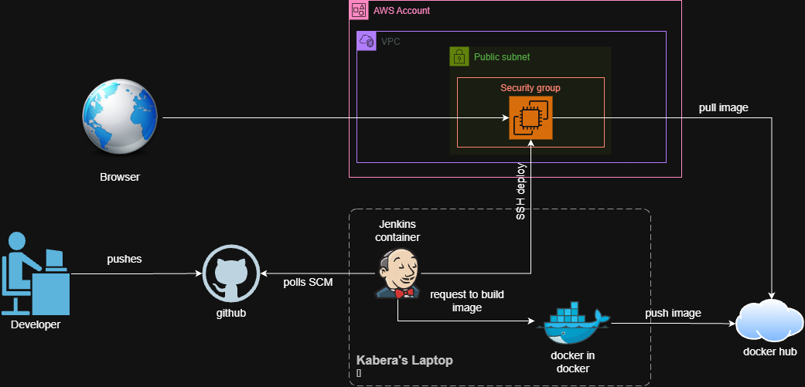

# Flask CI/CD Pipeline with Jenkins

An end-to-end CI/CD pipeline that builds, tests and containerizes a small Flask web service, pushes the image to Docker Hub, and deploys it to an EC2 host over SSH. Every push to `main` can go from commit to a running container with no manual steps.

## Architecture

Jenkins runs as a container on a local machine. Its builds use a separate Docker-in-Docker container as their Docker daemon, so images are built without touching the host's own Docker. The EC2 host never receives code directly: it pulls the exact image tag that passed the tests from Docker Hub.

## Repository layout

| Path | Purpose |
| --- | --- |
| `app.py` | The Flask application |
| `tests/test_app.py` | Unit and route tests (pytest) |
| `requirements.txt` | Runtime dependencies, installed in the Docker image |
| `requirements-dev.txt` | Runtime and test dependencies, installed by Jenkins for testing |
| `Dockerfile` | The application image: pinned Python base, non-root user, gunicorn |
| `.dockerignore` | Keeps the virtual environment, reports and Git data out of the build context |
| `Jenkinsfile` | The pipeline definition |
| `screenshots` | Directory with the evidence screenshots and architecture diagram image |

## The pipeline

| Stage | What it does |
| --- | --- |
| Checkout | Clones the repository at the commit that triggered the build |
| Build | Creates a virtual environment and installs the dependencies |
| Test | Runs pytest and publishes a JUnit report, even when tests fail |
| Docker Build | Builds the image, tagged with the build number and `latest` |
| Push Image | Logs in to Docker Hub with a scoped credential, pushes both tags, then logs out |
| Deploy | Over SSH, pulls the new image on EC2, replaces the running container, and prunes old images |
| Post | Removes this build's images from the build daemon and deletes the workspace |

A failing test stops the pipeline at the Test stage, so a broken build is never pushed or deployed. Each image is tagged with its build number, so the version running on EC2 is always traceable, and any earlier build can be redeployed.

## Application endpoints

| Route | Returns |
| --- | --- |
| `GET /` | An HTML page showing the running version (the Jenkins build number) |
| `GET /health` | `{"status": "ok", "version": "..."}` |
| `GET /api/add?a=2&b=3` | `{"result": 5.0}`, or a `400` error if a parameter is missing or not a number |

## Setup

### One-time setup

These persist between sessions and only need to be created once.

| Resource | Why it's needed |
| --- | --- |
| Docker Hub repository `kaberagclap/flask-app` (public) | Stores the images Jenkins pushes. Public, so the EC2 host can pull without logging in. |
| Docker Hub personal access token (Read & Write) | Lets Jenkins push images without using the account password. It can be revoked on its own. |
| GitHub repository | Holds the code and the Jenkinsfile. Jenkins reads the pipeline from it on every build. |
| SSH key pair, kept locally | The one key used to reach every EC2 host. Reusing it means the Jenkins credential never has to change between sessions. |
| Docker-in-Docker container | The Docker daemon Jenkins builds and pushes images with. |
| Custom Jenkins image and container | The official Jenkins image lacks the Docker CLI and Python's `venv`, which the Build, Test and Docker stages need. The Jenkins data volume keeps jobs, plugins and credentials across container rebuilds. |
| Jenkins plugins: Pipeline, Git, Credentials Binding, SSH Agent, JUnit, Docker Pipeline, Pipeline Graph View | Provide the steps the Jenkinsfile uses (`checkout`, `withCredentials`, `sshagent`, `junit`) and the stage view. |
| Jenkins credential `registry_creds` (username with password) | The Docker Hub username and access token, used only inside the Push Image stage. |
| Jenkins credential `ec2_ssh` (SSH username with private key) | User `ec2-user` and the private key, used only inside the Deploy stage. |
| Jenkins credential `git_credentials` (optional) | Only needed if the GitHub repository is private. |
| Jenkins pipeline job | Set to "Pipeline script from SCM", branch `*/main`, script path `Jenkinsfile`. |

### Per-session setup on AWS

| Resource | Configuration | Why it's needed |
| --- | --- | --- |
| Key pair | Import the public half of the local SSH key | Lets the instance accept connections signed with the key Jenkins already holds. |
| Security group `flask-app-sg` | Inbound SSH (port 22) from your current public IP; inbound HTTP (port 80) from anywhere | SSH is only for you and Jenkins, which both connect from your public IP. HTTP is open so the app can be reached in a browser. Note that HTTP and HTTPS are separate rules on separate ports. |
| EC2 instance `flask-app-host` | Amazon Linux 2023, `t3.micro` (or `t4g.micro` if the local machine has an ARM chip), default VPC, with Docker installed and `ec2-user` in the `docker` group | Runs the application container. Its CPU architecture must match the architecture the images are built for. |
| Elastic IP | Associated with the instance | Gives the instance a fixed address for the Jenkinsfile and the browser. |

The default VPC already has an internet gateway and a route to it. If the instance is launched into any other VPC, it also needs an internet gateway and a `0.0.0.0/0` route to it, or it won't be reachable.

## Running the pipeline

1. Set `EC2_HOST` in the Jenkinsfile to the new Elastic IP, then commit and push. Each session's Elastic IP is different.
2. In Jenkins, open the job and choose **Build Now**.
3. When the build finishes, open `http://<elastic-ip>/`. The version shown should match the build number.

## Teardown

Tear down the AWS resources after each session, in this order:

| Step | Why |
| --- | --- |
| 1. Terminate the EC2 instance | Stops compute charges. It goes first because the security group can't be deleted while an instance uses it. Terminating also detaches the Elastic IP. |
| 2. Release the Elastic IP | AWS bills for an Elastic IP while it's allocated, even when it isn't attached to anything. |
| 3. Delete the security group | It has no further use. Leaving it risks it being reused later with stale rules. |
| 4. Delete the key pair in AWS | Only AWS's copy is deleted. The local key stays and is imported again next session. |
| 5. Remove the Elastic IP's entry from Jenkins' `known_hosts` | AWS may later give the same address to a different machine. A leftover entry would make a future deploy fail with a host key mismatch. |

Nothing else needs tearing down between sessions: the Jenkins containers, credentials and Docker Hub repository are reused.

Also revoke the Docker Hub access token (and the GitHub token, if one was created), and delete the matching Jenkins credentials after the lab is no longer needed.
